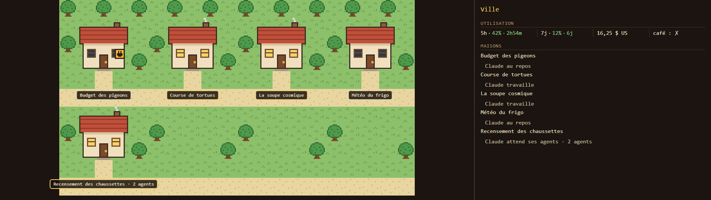
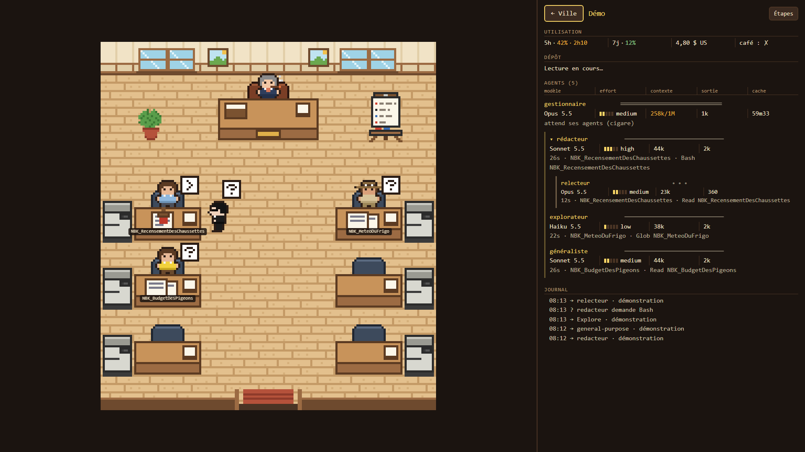
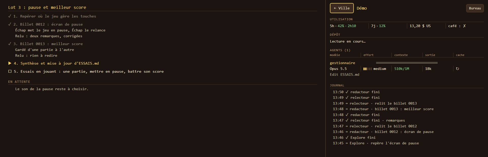
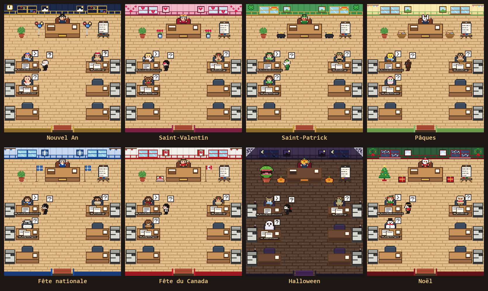

# bureau-agents

🇬🇧 [English version](README.md)

Un mod de Claude Code qui montre les agents de la session au travail, dans une ville et des bureaux en pixel art. Chaque session ouverte est une maison ; chaque sous-agent entre par la porte, travaille à son poste, puis ressort.



Clique sur une maison pour entrer dans son bureau :



Le bouton **Étapes** remplace le bureau par la liste d'étapes que Claude tient à jour pendant la séance. Le journal, à droite, résume qui est venu et comment ça s'est fini :



Le bureau se déguise tout seul pour les fêtes, selon le mois :



## Installer (Windows)

1. Cloner ce dépôt où on veut.
2. Installer Python 3, puis : `pip install pillow` (le bureau s'en sert pour convertir ses dessins).
3. Dans le dossier du dépôt :

   ```powershell
   powershell -ExecutionPolicy Bypass -File .\installer.ps1
   ```

4. Redémarrer VS Code, puis taper `/bureau`.

Le script sauvegarde d'abord `~/.claude/settings.json`, puis y ajoute le branchement du mod, sans toucher aux autres réglages. Il se relance sans danger.

## Ce qu'il y a dedans

| Dossier | Ce que c'est |
|---|---|
| `mod/` | Le mod : il écoute la session et écrit ce que la page affiche |
| `vue/` | La page : la ville, les bureaux, le panneau de droite |
| `personnages/`, `decor/`, `themes/` | Les dessins, dont un thème par fête du calendrier |
| `outils/` | Les scripts de dessin, la conversion des images (`construire.py`), une fausse session (`demo.py`) et l'anti-veille (`rester_eveille.ps1`), que le mod lance quand Claude travaille |
| `captures/` | Les captures de cette page |
| `bureau.json` | Le plan : les bureaux, les personnages par type d'agent, les thèmes |

## Licence

Tout est dans le domaine public ([CC0 1.0](LICENSE)) : le code comme les dessins. Prends, modifie, partage, sans rien demander.
