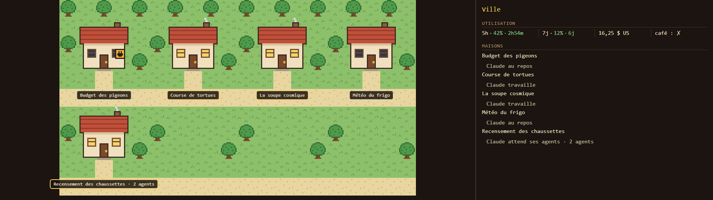
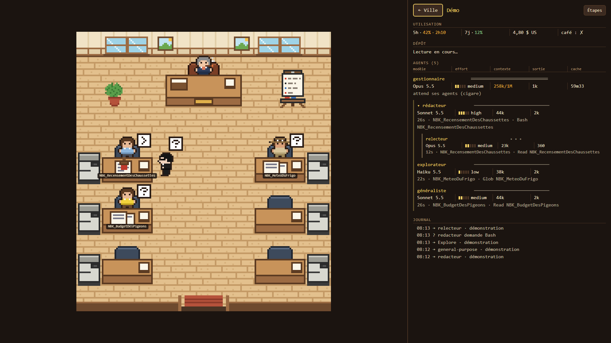
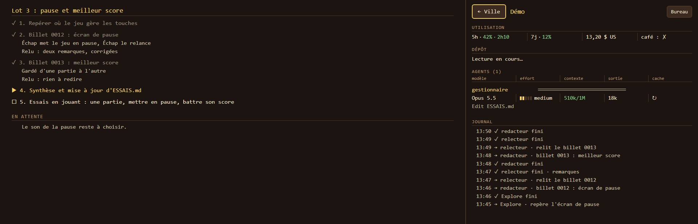
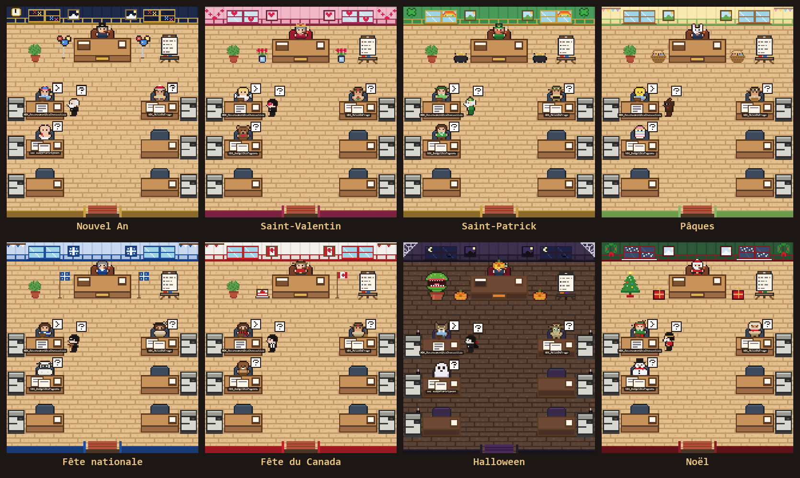

# bureau-agents

🇫🇷 [Version française](LISEZMOI.md)

A Claude Code mod that shows your session's agents at work, in a pixel-art town and offices. Each open session is a house. The main agent sits at the manager's desk; each subagent walks in through the door, works at its desk, then leaves.



Click a house to step into its office:



The **Étapes** button swaps the office for the step list Claude keeps up to date during the session. The log on the right recaps who came and how it ended:



> **Heads-up: the interface is in French.** The mod works the same for everyone, but the labels and messages on the page are in French.

The office dresses up for the holidays, on its own, according to the month:



## Install (Windows)

1. Clone this repository anywhere.
2. Install Python 3, then: `pip install pillow` (the office uses it to convert its drawings).
3. In the repository folder:

   ```powershell
   powershell -ExecutionPolicy Bypass -File .\installer.ps1
   ```

4. Restart VS Code, then type `/bureau`.

The script first backs up `~/.claude/settings.json`, then adds the mod to it without touching your other settings. It is safe to run again.

## What's inside

| Folder | What it is |
|---|---|
| `mod/` | The mod: it listens to the session and writes what the page shows |
| `vue/` | The page: the town, the offices, the side panel |
| `personnages/`, `decor/`, `themes/` | The drawings, including a theme for each holiday of the year |
| `outils/` | Drawing scripts, image conversion (`construire.py`), a fake session (`demo.py`) and a keep-awake script (`rester_eveille.ps1`) that the mod runs while Claude is working |
| `captures/` | The screenshots on this page |
| `bureau.json` | The floor plan: desks, characters per agent type, themes |

## License

Everything is in the public domain ([CC0 1.0](LICENSE)), code and drawings alike. Take it, change it, share it, no need to ask.
